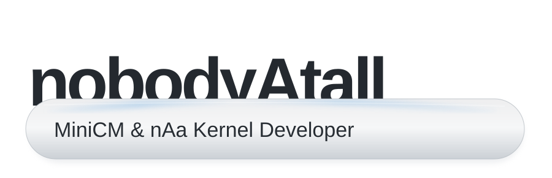

<picture>
  <source media="(max-width: 620px) and (prefers-color-scheme: dark)" srcset="assets/card-compact-dark.svg">
  <source media="(max-width: 620px)" srcset="assets/card-compact-light.svg">
  <source media="(prefers-color-scheme: dark)" srcset="assets/card-dark.svg">
  
</picture>

I'm **nobodyAtall (nAa)**, the developer behind **MiniCM**, unofficial CyanogenMod ports for the classic Sony Ericsson Xperia mini family, and the **nAa custom Linux kernels**. My work focuses on bringing newer Android versions to older devices through custom kernels, hardware bring-up, device-specific adaptations and open-source development.

<picture><source media="(prefers-color-scheme: dark)" srcset="https://raw.githubusercontent.com/jendermine/jendermine/main/assets/divider-dark.svg"></picture>

<h3><picture><source media="(prefers-color-scheme: dark)" srcset="https://raw.githubusercontent.com/jendermine/jendermine/main/assets/heading-projects-dark.svg"></picture></h3>

| Project | What it does | Platform |
| --- | --- | --- |
| **MiniCM6** | Early unofficial CyanogenMod / Froyo adaptation for Xperia mini devices | Android 2.2 |
| **MiniCM7** | Gingerbread-based CyanogenMod 7.2 adaptation for Xperia X8, X10 Mini and X10 Mini Pro | Android 2.3 |
| **MiniCM9** | Ice Cream Sandwich adaptation for the original Xperia mini family | Android 4.0 |
| **MiniCM10** | Jelly Bean-era MiniCM builds for small-screen Xperia devices | Android 4.1 |
| [nAa Kernel](https://github.com/nobodyAtall-code/nAa-kernel) | Custom kernel foundation for legacy Xperia Android ROMs | Linux / ARM |
| [nAa Kernel ICS](https://github.com/nobodyAtall-code/nAa-kernel-ics) | Kernel line used with the MiniCM9 / ICS generation | Linux / Android |
| [nAa Kernel JB](https://github.com/nobodyAtall-code/nAa-kernel-jb) | Jelly Bean-era nAa kernel development | Linux / Android |
| [MSM7x27 kernel](https://github.com/nobodyAtall-code/msm7x27-2.6.32.x-nAa) | Qualcomm MSM7x27 Linux 2.6.32 kernel sources | C / Linux |
| [MSM7x30 kernel 3.0](https://github.com/nobodyAtall-code/msm7x30-3.0.x-nAa) | MSM7x30 kernel development and platform bring-up | C / Linux |
| [MSM7x30 kernel 3.4](https://github.com/nobodyAtall-code/msm7x30-3.4.x-nAa) | MSM7x30 Linux 3.4 kernel source | C / Linux |

**Other legacy sources:** [MSM7x30 2.6.32](https://github.com/nobodyAtall-code/msm7x30-2.6.32.x-nAa) · [Sony Fuji kernel](https://github.com/nobodyAtall-code/kernel_sony_fuji) · [Sony Mogami common tree](https://github.com/nobodyAtall-code/android_device_semc_mogami-common) · [XperiaFeatures](https://github.com/nobodyAtall-code/XperiaFeatures) · [HTC Passion device tree](https://github.com/nobodyAtall-code/android_device_htc_passion) · [Samsung maguro vendor](https://github.com/nobodyAtall-code/android_vendor_samsung_maguro) · [Qualcomm display](https://github.com/nobodyAtall-code/android_hardware_qcom_display)

<picture><source media="(prefers-color-scheme: dark)" srcset="https://raw.githubusercontent.com/jendermine/jendermine/main/assets/divider-dark.svg"></picture>

<h3><picture><source media="(prefers-color-scheme: dark)" srcset="https://raw.githubusercontent.com/jendermine/jendermine/main/assets/heading-stack-dark.svg"></picture></h3>

| Layer | Technologies |
| --- | --- |
| Android | AOSP, CyanogenMod, MiniCM, Android device trees |
| Kernels | nAa Kernel, Linux 2.6.32 / 3.0 / 3.4, ARM |
| Hardware | Qualcomm MSM7x27 / MSM7x30, Sony Ericsson Xperia |
| Development | C, Linux, Git, shell, kernel configuration |
| Device integration | ClockworkMod Recovery, hardware drivers, kernel / ROM compatibility |

<picture><source media="(prefers-color-scheme: dark)" srcset="https://raw.githubusercontent.com/jendermine/jendermine/main/assets/divider-dark.svg"></picture>

<h3><picture><source media="(prefers-color-scheme: dark)" srcset="https://raw.githubusercontent.com/jendermine/jendermine/main/assets/heading-activity-dark.svg"></picture></h3>

### Milestones & recognition

| Year | Milestone |
| --- | --- |
| **2011–2012** | MiniCM and nAa kernels brought newer CyanogenMod generations to Sony Ericsson Xperia X8, X10 Mini and X10 Mini Pro. |
| **2012** | MiniCM9 / Android Ice Cream Sandwich releases reached the 2010 Xperia mini family. |
| **2013** | Booted a **Linux 3.0.8 kernel** on a **2011 Xperia Mini**, a development milestone covered by Xperia Blog. |

**Press & community coverage**

- [XDA Developers — 2011 Sony Ericsson Xperia devices taste Android 4.4 KitKat](https://www.xda-developers.com/2011-sony-ericsson-xperia-devices-taste-android-4-4-kitkat/)
- [Xperia Blog — Dev manages to boot 3.0.8 kernel on 2011 Sony Xperia device (2013)](https://www.xperiablog.net/2013/04/14/dev-manages-to-boot-3-0-8-kernel-on-2011-sony-xperia-device/)
- [An audience with nobodyAtall — MiniCM developer interview](https://xperiaminicyanogen.wordpress.com/interviews/an-audience-with-nobodyatall/)
- [MiniCM9 releases and community coverage](https://xperiaminicyanogen.wordpress.com/2012/05/08/minicm9-xda-links/)

**XDA achievements:** [View achievement badges and community profile](https://xdaforums.com/m/nobodyatall.788040/#adav_achievements)

<picture><source media="(prefers-color-scheme: dark)" srcset="https://raw.githubusercontent.com/jendermine/jendermine/main/assets/divider-dark.svg"></picture>

<h3><picture><source media="(prefers-color-scheme: dark)" srcset="https://raw.githubusercontent.com/jendermine/jendermine/main/assets/heading-connect-dark.svg"></picture></h3>

  

Historical development portfolio. Legacy repositories and project names are retained for reference; they are not claims of active maintenance.
